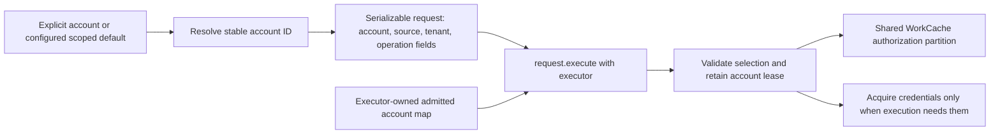

# Accounts, runtime verification, and request-first callers

**Status:** U135 foundation and R1–R12 account/CLI ownership refinement complete.
**Updated:** 2026-11-10
**Root:** Repository root (`.`).
**Authority:** U123–U135 in the [migration plan](executor-cache-migration.md).

The migration plan owns the original guidance ledger and validation evidence.
The [account authentication resolution cutover](account-authentication-resolution-cutover.md)
records the newer R1–R12 contracts: shared provider ownership, multi-source
accounts, flattened leaf authentication arguments, and optional account selectors.
The contracts below incorporate that refinement; earlier implementation evidence
remains recorded in the foundation validation document.
No live credentials or production
data were used for development. All changes remain uncommitted.

## Closed decisions

| Gate | Implemented decision |
| --- | --- |
| A1: account selection | Stable `CloudTerrastodonAccountId`; aliases/defaults scoped to Entra tenant, DevOps organization/Server collection for PATs, or Gitea instance. An explicit ID or scoped alias overrides a deliberately configured default. There is no first-account or ambient-login fallback. |
| A2: serialized intent | Bearer selection contains account ID, concrete source, and tenant. DevOps selection distinguishes bearer and account-selected PAT. Gitea requests name account ID and instance. The shared provider initializes selected account/source sessions lazily; each request admits its exact selection before cache reuse. |
| A3: continuity and retirement | Automatic renewal retains the admitted binding. Entra provisioning verifies the same tenant-local principal before attaching or replacing a mechanism without changing account ID. Unverified replacement requires a new account. Retirement closes admission, signals optional work, drains leased required work, and invalidates the retired authentication partition and recorded dependencies. |
| A4: provider ownership | All five sources have explicit provisioning: isolated Azure CLI, account-owned browser refresh credentials, explicit workload assertion input, account-owned PAT, and a captured tea profile. Ordinary execution never imports legacy credentials or follows external defaults. |
| V1: runtime verification | Separate runtime-test registration with direct executable descriptors. `ct test run <pattern>` selects exact names or full-name `*`/`?` globs. Typed explicit inputs and full effect-subset admission precede execution. `--clean` only drives existing request invalidation. No replay/decoder-only mode. |

## Account identity and request data

CT-owned identities use the `CloudTerrastodon` prefix. Service records and
requests retain `Azure`, `Entra`, `AzureDevOps`, or `Gitea` prefixes.
The cutover renames the resource-group and storage-account families and other
inconsistent request names with their owning files, registrations, and callers.
There are no compatibility aliases.

An account profile identifies a principal within its tenant or service namespace
and owns its registered credential mechanisms. The alias is for selection and presentation;
it is neither a permission guarantee nor part of immutable request identity.
Entra accounts can serve several supported audiences without separate account
registrations for Graph, ARM, and DevOps. Request scope remains independent:
DevOps organization/project do not become tenant identity, and PATs do not acquire
a fictitious tenant.

`Auto` is CLI resolution policy, never a concrete bearer request source.
`None` rejects authenticated service execution and login/import before account
lookup. Local account catalogue/cleanup operations remain available. Azure CLI
bearer requests always contain an explicit resolved tenant. Tenant aliases and
the deliberately configured CT tenant default are resolved before constructing
requests; Azure CLI's active subscription/tenant is never consulted.



Saved requests retain the selected account even after aliases/defaults change.
A reviewed admin-account read and a requester-account mutation each display their
own identity. The executor cannot substitute one for the other. Missing accounts,
source/tenant conflicts, and service-target mismatches fail before result reuse.
No request resolves aliases, defaults, or global profiles during execution.
A workflow engine is not introduced by this migration.

`AzureBearerAuthenticationSelection` is pure data. Shared flattened CLI
authentication arguments resolve tenant, account, and source metadata before
constructing the request. Runtime context binders are removed:

```rust
AzureResourceGroupListRequest {
    authentication: self.authentication.resolve(executor).await?,
}
.execute(executor)
.with_invalidation(invalidate)
.await?;
```

Operation fields preserve `Cow` borrowing. Cached outputs remain `Arc` values,
and request-specific errors such as `PickError` pass through execution unchanged.
The equivalent `executor.execute(request)` API remains available to generic
infrastructure.

## Provider lifecycle and cache coordination

CLI, browser, PAT, workload, and Gitea sessions live in the shared provider map,
initialized on first admission from explicitly registered credentials.
Provider/executor clones share session ownership; unavailable selections never
fall back to another account or source. Credential generations and tokens remain
runtime details, absent from approval/request data and printable cache keys.

Account login creates an isolated credential generation. Entra login verifies the
tenant-local principal before activating a replacement or additional mechanism.
Active sessions require explicit logout before replacement. PAT and Gitea
credentials lack this continuity proof and require a new account after retirement.
An existing executor rejects new admission after its selected registration changes;
already admitted leases retain their original generation through required completion.
Automatic token renewal preserves that session's identity. Reusing an alias after
removal never reuses the old account ID.

Retirement has two stages: close new admission and cancel optional work, then
drain already admitted required completion before releasing credential resources.
An admitted mutation retains its account through response decoding, artifact
publication, and affected-read invalidation. Logout must not introduce a final
admission failure between a successful remote write and its required cleanup.
Linked cancellation preserves ancestor deferrals.

`CacheInvalidationTarget::Authentication` invalidates every entry namespace for
the selected partition, including disk eligibility, without erasing sibling
account results or retained diagnostic attempts. Generation checks reject late
publication. Recorded dependencies invalidate a composed result under account A
when its account-B child retires. Ordinary resource invalidation still crosses
account variants because a mutation can affect several accounts' views.

Already returned `Arc` snapshots remain readable. These coordination guarantees
apply to one session owner/shared cache handle. Durable retirement prevents new
invocations from reopening a retired credential generation; a separate logout
process cannot instantly cancel an already running UI. Phase 8 owns any stronger
cross-process contract.

First-login/import generations are durably marked as provisioning before writes,
so interrupted attempts cannot authorize requests and cleanup can be retried.
Legacy import is explicit. Normal startup never adopts ambient Azure CLI,
tenant-wide browser settings, or a global PAT automatically.

See [authentication](../authentication.md) for exact account commands, storage,
source-specific provisioning, renewal limits, and legacy import.
[Authentication execution](../auth-execution-migration.md) describes SDK/provider
boundaries. Production account resolution is covered by synthetic source-specific
selection, target-validation, immutable-request, lease, and retirement tests.

## Runtime verification

Ordinary Cargo tests cover domain invariants, policy, synthetic cache/cancellation,
loopback HTTP, and controlled local processes/files. Actual credential acquisition
and current API-response compatibility belong to deliberate runtime verification.
The [runtime inventory](runtime-test-cutover-inventory.md) classifies removed live
entrypoints and retained offline tests; temporary cache ownership alone does not
make a test offline.

A test registration has a direct executable descriptor, name, effects, input
shape, and execution callback. It is distinct from ordinary discovery admission.
For a check whose only responsibility is executing and decoding an existing SDK
request, registration directly uses that request: an identical forwarding test
struct would add no contract. Checks with additional assertions/workflow steps
own a separate executable request and explicit effects. No new execution framework
or `Test` effect is introduced.

```text
ct test list
ct test run resource-group-list --account admin --tenant example
ct test run resource-group-list --account admin --tenant example --clean
ct test run "*" --account admin --tenant example --allow-effect read --clean
```

The name is a positional full-name pattern, not a per-test subcommand. Literal
names, `*`, and `?` operate on registered names. No matches is an error.
Listing reads metadata only, without accounts, defaults, requests, or services.
Additional operation inputs come from an explicit JSON object keyed by case name,
with typed request decoding. Common tenant/org/project/instance flags supply only
fields declared by the selected request. Unknown/missing/conflicting fields fail;
arbitrary generation and discovery do not synthesize live inputs.

The default allowed effect is `Read`. Every declared effect must be allowed:
`[Read, Write]` is not admitted by `[Read]`. `Solicit` must be explicitly
allowed. Writes require deliberate typed targets; registration does not invent
rollback or disposable resources. Obsolete manual experiments were removed with
a recorded disposition instead of being disguised as automated tests.
Normal cache/artifact persistence and report rendering do not make a read a
domain write. Deliberate file export/configuration changes remain `Write`.

`--clean` defaults to false. The runner warns on stderr when omitted, since
eligible cached results may be reused and a miss can still contact the service.
Both values use the same `.execute(executor).with_invalidation(clean)` contract.
No separate replay command, response selector, mandatory new cache directory,
or test-only cache bypass exists. Cases delegate invalidation to their underlying
requests, including composed children in separate branches. Mutation attempts
already execute each time; cleaning does not turn a mutation into replay.

A decoded memory hit skips deserialization; an eligible raw disk hit uses the
current decoder. Failed-decode artifacts remain diagnostic attempts, not reusable
successes. Retrying may fetch again. Credential partitions may prevent
cross-invocation reuse. None of these normal cache contracts is weakened for
parser diagnosis.

Reports contain typed pass/fail/skip/cancelled outcomes, build strictness, coverage,
and cache observations without inventories or credential payloads. Initializations
include disk decoding/composition and are not claimed as network exchanges.
An empty list can cover its envelope without exercising item records.
Debug unknown-field checks are reported honestly; release decoding is less strict.
A cached pass is never evidence of current live API compatibility.

Cases run serially, awaiting every admitted future. Ordinary failures become report
data; cancellation closes further admission and drains required work. The runner
emits its partial report before returning failure. Zero completed cases, failures,
and cancellation produce non-success outcomes. Verdicts are not memoized.
See [runtime verification](../runtime-verification.md) for the operator surface.

## Complete caller cutover

Trivial functions that only constructed/bound requests were removed throughout
SDKs, CLIs, UIs, examples, tools, and tests. Callers construct named fields and use
`.execute(executor)`. Meaningful aggregations, validating constructors, and
cancellation-only local workflows retain their own responsibilities. No new
`Options` bag or replacement forwarding helper hides the fields.

App startup records auth preferences without credential/configuration lookup.
Every invocation owns a shared cache; `App::work_cache` permits explicit ownership
and temporary-cache fixtures. Local operations still take a scope when they need
no executor services. UI and registry requests contain no runtime cancellation
fields, and the former `IntoFuture` registration/cancellation-injection bridge
has been removed.

Azure audit activities are independent serializable requests with typed findings.
They share existing memoized inventories without a World object. This preserves
existing audit policy and uses one output boundary; it does not silently extend
Azure DevOps audit policy.

The migration plan records task evidence for 6.0a–6.0e, 6.1–6.3, and 7.1–7.2.
Linux/live-provider evidence and cross-process coordination limits remain explicit.
