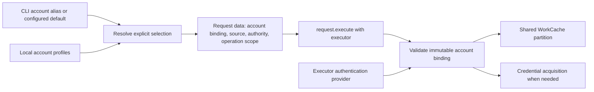

# Accounts, runtime verification, and request-first callers

**Status:** Design refinement for Phase 6; implementation has not started.
**Updated:** 2026-11-09
**Root:** Repository root (`.`).
**Authority:** U123–U132 in the [migration plan](executor-cache-migration.md).
That plan owns progress, the guidance ledger, and authorization. This companion
owns the proposed contracts, decision gates, and source evidence. Choices marked
recommended are not yet user decisions. No live credentials or data were accessed.

## Confirmed direction and verified foundation

The user requests multiple selectable accounts within one tenant/service,
intentional registered runtime tests instead of accidental live Cargo tests, and
direct `Request { ... }.execute(executor)` callers instead of trivial fetch
functions. U127 selects aliases scoped by tenant or service instance. U128 permits
deliberately configured account defaults. Neither allows ambient Azure CLI account
selection or choosing the first available account. This is planning work before
the previously scheduled audit extraction, not authorization to implement it.
U129 requires domain-qualified type names so CT-owned account identities are
clearly distinguished from service resource identities.
U130 makes freshness optional through `ct test run --clean`, with a warning when
omitted and cached-response diagnosis supported deliberately. U131 clarifies
that each serialized request names its execution account/source/tenant for human
approval while the executor owns credentials. U132 accepts separate test
registration rather than a test effect.

| Verified source | Finding and implication |
| --- | --- |
| [AuthenticationSelection](../../crates/auth_types/src/authentication_selection.rs), [DevOps selection](../../crates/auth_types/src/azure_devops_auth_selection.rs) | Bearer selection names source and tenant; PAT has no account selector. Add non-secret account identity without merging organization/project scope into authentication. |
| [Azure CLI sessions](../../crates/auth/src/azure_cli_sessions.rs), [session store](../../crates/auth/src/azure_cli_session_store.rs) | Selected CLI login generations are indexed by tenant. Two independently selected users in the same tenant need separate bindings and storage. |
| [Browser acquisition](../../crates/auth/src/browser_access_token.rs) | One browser-session file and refresh-token slots keyed by tenant/OAuth client do not distinguish two users of that client in one tenant. |
| [PAT acquisition](../../crates/auth/src/azure_devops_pat.rs), [credential manager](../../crates/auth/src/windows_credential_manager.rs) | Current global PAT environment/credential-manager selection cannot name independent PAT accounts. |
| [AuthContext admission](../../crates/auth/src/auth_context.rs), [workload identity](../../crates/auth/src/workload_identity.rs) | CLI/browser/PAT partitions already use session identity; workload partitions include tenant and client ID. Missing account selection is not evidence of an existing tenant-only cache leak. Preserve these protections. |
| [Gitea login](../../crates/gitea/src/gitea_login.rs), [API support](../../crates/gitea/src/gitea_api_support.rs) | Multiple tea profiles for one instance are rejected. External profile names cannot prove credential generation, so existing result reuse is deliberately disabled. |
| [Resource-group request](../../crates/azure/src/resource_group_list_request.rs), [Azure test executor](../../crates/azure/src/test_executor.rs) | Unignored `it_works` uses a real credential provider and configured tenant alias. Temporary cache ownership does not make execution offline. |
| [Resource-group request](../../crates/azure/src/resource_group_list_request.rs), [storage-account request](../../crates/azure/src/storage_accounts.rs) | Both still retain `Cow<AzureTenantAuthContext>`. Executor propagation is complete for these callers, but request/context separation is unfinished; 6.0d owns the full data-only cutover. |
| [DevOps projects](../../crates/azure_devops/src/azure_devops_projects.rs) | Live project testing reads configured organization/test tenant. The same module also has a useful offline reflected-clone test; classify individual tests, not whole files. |
| [Effects](../../crates/registry/src/effect.rs) | Read/Write cover service, filesystem, and application state. Ordinary cache/diagnostic artifacts do not make reads into domain mutations. |
| [DiscoveryPlan](../../crates/registry/src/discovery_plan.rs) | Type reachability is not an executable schedule and cannot establish organization/tenant correlation. A runtime test runner must not infer valid live inputs merely from matching shapes. |
| [ExecutableRequest](../../crates/execution/src/executable_request.rs), [RequestExecution](../../crates/execution/src/request_execution.rs) | Request-first execution already delegates to the same binding, invalidation, observation, cancellation, and typed-error contract. No additional execution framework is necessary. |

Initial test triage found 113 `test_executor::test_executor(...)` call sites in 85
Azure/DevOps source files. This is a candidate count, **not a count of live tests**;
some reject invalid input before any I/O. Other live/auth/config/process tests may
not use that helper. Recompute and classify during implementation.

## Account model

### Type names identify the owning domain

Use `CloudTerrastodonAccountId` for CT's local account identity. The containing
crate is not enough to communicate that distinction once a type is imported.
Apply the same prefix to CT-owned account profile, alias, and binding types when
those concepts need types; for example, a separate binding identifier would be
`CloudTerrastodonAccountBindingId`. This names an existing responsibility and
does not require introducing additional types solely for naming symmetry.

Service types retain their service namespace. Include the existing inconsistent
families in task 6.0d's naming inventory:

| Current/provisional name | Planned name | Meaning |
| --- | --- | --- |
| `AccountId` in this proposal | `CloudTerrastodonAccountId` | CT's local credential profile identity, not a remote user or resource ID. |
| `ResourceGroupListRequest` | `AzureResourceGroupListRequest` | Azure resource-group operation. |
| `StorageAccount` | `AzureStorageAccount` | Azure storage resource, unrelated to a CT authentication account. |

Use the established `Azure`, `AzureDevOps`, and `Gitea` domain prefixes where
applicable. Generic execution/cache concepts do not become CT account concepts
merely because this repository implements them. Alias lookup namespaces (tenant
or service instance) remain a separate concern from Rust type-name prefixes.

Rename each affected family and its owning files, imports/re-exports, registry
references, tests, and examples together without compatibility aliases. Audit
related IDs/names/requests rather than only the top-level record. Check reflected
type names and any serialization/fingerprint consumers; a Rust rename must not
accidentally change service wire fields, CLI spelling, or semantic cache scopes.
The examples below that explicitly describe current source retain its current
names until implementation; proposed runtime tests use the planned names.

### Identity and ownership

Separate the concepts rather than extending tenant IDs to mean accounts:

| Concept | Proposed responsibility |
| --- | --- |
| Account profile | Stable local `CloudTerrastodonAccountId`, scoped human alias, concrete source-specific credential binding. It selects credentials; it is not itself proof of a remote principal. |
| Authentication source | How credentials are obtained: isolated Azure CLI, browser, workload identity, PAT, or a service-specific provider. `Auto` is resolution policy, not a persisted concrete account identity. |
| Authority and audience | Explicit Entra tenant/authority and target resource where applicable. One admitted Entra account may acquire ARM, Graph, and DevOps tokens; these are not three required account registrations. |
| Request scope | Organization, project, subscription/resource, Gitea instance, filters and limits. These remain operation data, independent of credential selection. |
| Approved account identity | Stable CT identity referring to the selected principal/credential binding, with provider-supported evidence where available. It must not silently be repointed to another principal. |
| Runtime session | Provider-owned tokens, credential generation, and admitted account binding, plus invocation identity. Login/token generations remain runtime/cache details rather than mandatory request fields. Cancellation/cache ownership remains with the executor. |
| Cache authorization partition | Derived from admitted account/session identity, never just a human alias, tenant, email address, or credential bytes. Account selection is checked before a warm cache hit. |



Recommended alias namespaces are an Entra authority/tenant for Entra credentials,
an organization/service scope for a DevOps PAT, and an instance for Gitea. Exact
lookup syntax and whether aliases may reference one profile across namespaces
remain gate A1. Keep Entra aliases shared across audiences unless there is a
concrete reason to distinguish them. An alias called `admin` conveys no permission
guarantee. Rename changes the alias, not account identity.

An explicitly configured default resolves to a stable account ID in the applicable
namespace. It must not change an already constructed request or running executor.
An absent, removed, incompatible, or ambiguous default produces a useful error;
there is no first-account fallback. `--account` overrides the configured account
default. Defaults never supply otherwise-required `--org`/`--project`, and cannot
introduce a new implicit tenant selection policy. Bearer request data still names
its resolved tenant explicitly. Anonymous execution needs no account lookup.

Request intent contains the stable approved account identity, concrete source,
and explicit tenant when relevant. These identify whose credentials the operation
uses, how they are acquired, and the token authority. An alias/default is a
selector resolved before approval; execution must not resolve it again to a
different account. Token/session generations need not be serialized. This refines
the earlier recommendation to freeze every login revision: credentials can renew
without changing the approved account.
Admission must reject conflicting combinations rather than silently overriding
one field from another. The exact enum/newtype shape belongs to A2; avoid unrelated
optional fields or runtime handles in the serializable selection. Requests name
credentials without serializing credentials or token caches.

U131's mixed-account workflow favors an authentication provider holding an
explicit, invocation-owned mapping from `CloudTerrastodonAccountId` to admitted
runtime sessions. Each request selects its own entry. A CLI invocation may supply
one entry; a reviewed workflow may supply several authorized accounts. Missing
accounts and source/tenant mismatches fail before cache reuse, without falling
back to another supplied account. No request rereads global profiles/defaults.
Derived executors remain useful, but callers should not need to manually rebind
one for every request whose serialized data already selects its account. Gate A2
owns the exact contract and preservation of lineage/shared-cache ownership.

For the user's approval example, a resource-group-name check contains an
`AzureResourceGroupListRequest` selecting the approved admin account, source, and
tenant, even when the person proposing creation uses another account. The
reviewer sees that choice beside the operation scope. Each later operation names
its own intended execution account; approving an admin read does not implicitly
approve an admin write. Changing the resolved account/source/tenant changes the
reviewed request. Alias display text can aid review but is not its identity.
This requires inspectable request data and validation, not implementation of a
new workflow engine in this migration. A mutation's necessary fresh preflight
remains explicit independently of the runtime test command's optional `--clean`.

Account replacement and logout are not ordinary data invalidation. Gate A3 must
define new-admission rejection, old-handle behavior, and in-flight completion.
An old handle must never silently switch principal. Alias reuse after removal
gets a new stable ID. A different principal requires a new approved account
binding identity and reconstruction/reapproval of affected requests. Token
refresh or credential renewal for the same established identity changes private
session/cache generations as needed, not the request's account merely because
the login changed. Where continuity cannot be established, reject reuse of that
approved identity or establish a new binding; a matching alias/email/slot is not
proof. Review provider-supported identity mechanisms rather than inventing token
parsing or extra identity probes. Preserve current conservative session
partitioning initially; persistent cross-invocation result reuse remains a
separate contract, not an automatic consequence of named profiles.

Required completion already owed must still drain. Closing account admission must
not make a successful dispatched write fail at a final auth check before its
affected-read invalidation runs. The executor currently rechecks admission after
`work.await` in [await_admitted_work](../../crates/execution/src/cloud_terrastodon_executor.rs).
A3 needs an admitted-work lease or equivalent distinction: stop new jobs, cancel
optional jobs, retain the old binding for bounded response/artifact/invalidation
completion, then release its credential resources. Local draining cannot guarantee
that remotely revoked credentials will still succeed. Previously returned `Arc`
snapshots remain readable after logout; local invalidation cannot retract them.

Account changes must reach aggregate request admission as well as REST pages.
Otherwise a composed cache hit could skip child admission. Preserve recorded child
dependencies: a parent under account A consuming account B must become stale when
B's binding retires. Include all selected bindings in mixed-account request
identity, and advance retired-partition dependency generations even when a future
parent hit would never consult B's provider. Current [WorkDependency](../../crates/cache/src/work_dependency.rs)
stores full entry identity, but [CacheInvalidationTarget](../../crates/cache/src/cache_invalidation_target.rs)
currently offers scope/exact-entry targets, not a complete account-lifecycle
invalidation contract. A3 must specify that coverage and prevent old publication.

Preserve logical resource invalidation across account variants: one account's
mutation can affect another account's view. Provider logout must not invalidate
unrelated accounts' credential state. Exact close/drain/generation guarantees
initially cover one session owner and shared cache handle. A separate
`ct account logout` process cannot instantly cancel an existing UI process's captured provider
without additional coordination. Durable retirement can prevent reopening a
retired credential-session generation in a new invocation; other running
processes' behavior must be stated
explicitly. Do not expand the shared-handle cache guarantee into cross-process
coordination; Phase 8 remains separate.

### Platform constraints

- Azure CLI exposes tenant/resource/subscription token selectors, not a general
  human account selector on `get-access-token`. Its configuration supports
  `AZURE_CONFIG_DIR`. Extending CT's existing isolated login generations to account
  bindings is a design inference from those facilities; relying on whichever user
  is active in the ambient CLI is not the proposed mechanism. See the official
  [token command](https://learn.microsoft.com/en-us/cli/azure/account?view=azure-cli-latest#az-account-get-access-token)
  and [configuration location](https://learn.microsoft.com/en-us/cli/azure/azure-cli-configuration?view=azure-cli-latest#cli-configuration-file).
- Workload federation authenticates a workload through an app registration or
  managed identity and a configured trust. Multiple accounts here mean multiple
  configured workload identities, not interactive human logins. Selection needs
  the intended tenant/client and assertion source; a short-lived assertion is not
  profile metadata. See [workload federation](https://learn.microsoft.com/en-us/entra/workload-id/workload-identity-federation)
  and the [federated client-credential exchange](https://learn.microsoft.com/en-us/entra/identity-platform/v2-oauth2-client-creds-grant-flow#third-case-access-token-request-with-a-federated-credential).
- DevOps supports Entra-connected and standalone organizations. Entra token
  acquisition for DevOps targets its own resource audience; PAT selection does
  not require inventing an Entra tenant. Keep organization scope distinct, while
  validating any constraints required by the selected credential mechanism. See
  [organization identity configurations](https://learn.microsoft.com/en-us/azure/devops/organizations/accounts/access-with-azure-ad?view=azure-devops)
  and [DevOps Entra tokens](https://learn.microsoft.com/en-us/azure/devops/cli/entra-tokens?view=azure-devops).

### CLI candidate, not an implemented interface

Recommend a top-level `ct account` group because account lifecycle crosses SDKs.
Source-specific add/login variants should reject irrelevant inputs rather than
share an unvalidated parameter bag. Illustrative commands:

```text
ct account add entra --tenant example --name admin --auth-source azure-cli
ct account add entra --tenant example --name user --auth-source browser
ct account add azure-devops --org example --name automation --auth-source pat
ct account add gitea --instance https://gitea.example.invalid --name admin
ct account list
ct account show ...
ct account login ...
ct account logout ...
ct account default set ...
ct account default clear ...
ct account remove ...
```

`add` records a local profile, `login` provisions its credential session, `logout`
invalidates that session, and `remove` removes the local profile. None means
deleting a remote identity or revoking all of its remote credentials. Exact
secure PAT input and external Gitea-profile binding require provider-specific
design. Do not accept secrets as ordinary serialized request fields or expose
them through list/show. Tenant tracking remains useful for tenant names/defaults;
it no longer stands in for account registration. Legacy tenant login selections,
browser files, and PAT slots need an explicit migration without silently merging
users or importing ambient credentials.

## Runtime verification and Cargo tests

Use normal executable requests such as `AzureResourceGroupListRequestTest` for actual
service verification. Each owns a meaningful check/report and composes the
production SDK request; it does not copy URL/pagination/decoding logic. A test
may contain the underlying request as its typed input rather than repeat all its
fields. Place cases beside their owning SDK operations with one type per file.

Use a distinct registry test registration, linked to the existing executable
registration, following the dedicated-registration pattern exemplified by
`ArbitraryRegistration`. U132 accepts this separation; exact type/macro names
remain V1. `Test` is not an effect: a test may read, write, or solicit. Retain
nonempty actual effects, including the union of workflow steps.
Test registration must not make checks ordinary unattended discovery candidates;
discovery and the test runner need explicit purpose admission policies. Preserve
direct registry handles instead of introducing scans or duplicate executors.

| Operation | Where it belongs / effect |
| --- | --- |
| Domain invariants, owned policy, synthetic cache/cancellation, loopback HTTP, controlled local subprocess fixtures, temporary-file lifecycle | Cargo tests; no ambient service credentials or production configuration. |
| Real credential acquisition, current service-response validation, operator-selected integration/interactive checks | Registered runtime cases with explicit account/scope and actual effects. |
| API read that persists ordinary cache/diagnostic artifacts | `Read`; existing effect contract already covers this distinction. |
| Deliberate file export/configuration change, even without a remote mutation | `Write`, plus `Read` when applicable. Local writes are still observable effects. |
| Interactive selection/confirmation | `Solicit` in addition to other effects; excluded from unattended runs. |

No new local-file effect is needed for the first version. If users later need to
allow local writes while denying remote writes, model effect targets explicitly
and audit declarations; do not redefine `Read`. Rendering the runner's ordinary
result report is presentation, not a reason to mark every read case as a write.

Illustrative interface:

```text
ct test list
ct test run resource-group-list --tenant example --account admin
ct test run resource-group-list --tenant example --account admin --clean
ct test run --all --allow-effect read --tenant example --account admin --clean
```

Configured account defaults may replace `--account` under U128. `list` inspects
registration metadata only, without resolving defaults, credentials, or live
inputs. Running is always an intentional CLI action; implementing the runner does
not authorize its live invocation during development.

Runner requirements:

1. Select only registered verification cases. An allowed-effect filter is a
   **subset check**: `[Read, Write]` is not admitted by `[Read]`. Exclude `Solicit`
   from unattended execution. Effect declarations need review; they are not a
   security sandbox. A write case also requires its explicit resource inputs.
2. Construct cases from deliberate typed inputs. Tenant/org/project/resource
   identities must remain correlated. Missing inputs are reported, not filled by
   arbitrary generators, ambient defaults, or unrestricted discovery traversal.
   An explicitly selected case with missing inputs fails admission; batch cases
   may report skipped reasons. A run with no admitted cases must not look passed.
3. `--clean` is optional and defaults to false. Without it, permit normal eligible
   cache reuse and warn that responses may be cached and current live compatibility
   is not established. Keep the warning out of structured stdout, and record the
   mode/provenance in the report. A cache miss may still fetch; this is not an
   offline-only switch. With `--clean`, invalidate the selected cases' underlying
   read requests before reuse, using the existing `.with_invalidation(clean)` and
   request invalidation contracts. Cover memory, disk, pages, and composed children
   in separate cache branches. Invalidation failure prevents the affected case
   from proceeding. Do not log out accounts, erase unrelated caches, or invalidate
   mutation results as a substitute for their always-execute contract. This
   supersedes the mandatory new-cache-root recommendation.
4. Separate decoding success from coverage. An empty list can verify its envelope
   but not item schemas; do not universally fail an authorized empty tenant/org.
   Report counts/coverage and any operation-specific assertions.
5. Report strictness honestly. Current unknown-field checks depend on
   `debug_assertions`; release decoding is more permissive. Recommend reporting
   this mode initially and using a debug build for strict development verification.
   A future opt-in strict-response build feature is a separate choice, not an
   assumed capability of `ct test`.
6. Return typed pass/fail/skip/cancelled outcomes, coverage, and useful errors
   without dumping inventories. Keep normal artifacts under existing retention
   policy and avoid sensitive payloads in default reports. Use scoped concurrency;
   non-cancellation case failures become report data so other admitted cases can
   finish. Cancellation remains control flow: close admission, do not start queued
   cases, and drain required completion before emitting a cancelled/partial report
   with a non-success exit. Do not swallow `CancellationError` as an ordinary
   failed case and continue scheduling. The runner must own its shutdown/reporting
   future cooperatively, using the existing application cancellation policy so an
   automatic ancestor cannot drop the drain or final partial report.
7. Classify mutations individually. Use explicit targets/disposable resources and
   documented cleanup, including partial failure/cancellation. Do not invent
   automatic rollback for arbitrary operations or silently drop useful write
   checks. Obsolete manual experiments may be removed with recorded rationale.

### Clean runs, cached checks, and decoder diagnosis

`RequestExecution::with_invalidation` invokes the bound request's invalidation
contract; it does not automatically walk arbitrary nested requests. A test can
delegate that contract to all of its constituent reads. Own-key invalidation
covers descendants such as pages; composed cases must also cover non-descendant
child requests, as principals/RBAC already do. Child-to-parent dependency
invalidation does not imply that invalidating a parent clears all its children.
V1 must cover dynamically discovered child reads and repeated/shared reads within
a run without an unnecessary global purge or assuming a prior cache dependency
graph is complete. Record where one refreshed exchange is shared by cases rather
than claiming every case performed an independent exchange. Never memoize verdicts.

U130's parser-debugging motivation needs a separate distinction: a decoded memory
hit skips deserialization, while a selected raw artifact can be decoded again.
Current REST execution retains failed-decode artifacts but does not publish them
as reusable successes. A normal retry after a fresh decode failure therefore
fetches again; simply omitting `--clean` cannot yet guarantee repeated decoding
of that exact failed response. CLI/browser/PAT invocation partitions can also
prevent normal reuse across separate program invocations.

Include a deliberately selected saved-response decoding path in V1/6.0b so parser
changes can be checked against the same retained response without another API
call. Keep it distinct from normal result-cache acceptance: bypass typed-memory
hits, identify the original artifact/account/request and response age, report
saved-response provenance, and never turn a failed attempt into a normal cached
success merely to replay it. Do not resend captured mutations. Respect retention
and input-integrity rules; unavailable artifacts produce a clear diagnostic.
Exact selection/API/CLI spelling remains a design gate, not an implied automatic
fallback on every failure. Validate only with synthetic saved responses during
development; this task does not authorize reading existing production artifacts.

`#[ignore]` and test-tenant environment variables do not establish the final
separation. Remove live Cargo entrypoints and ambient test-provider helpers once
their cases move. Retain useful offline tests in the same modules, using existing
synthetic/unreachable providers where necessary. Inspect auth/config/filesystem
and process tests beyond SDK `test_executor` callers. Broad `test.ps1`/Cargo runs
remain prohibited during development until this classification and isolation are
complete; `cargo --offline` only constrains dependency acquisition.

## Request-first cutover

The existing API already supports the desired spelling. With today's fields:

```rust
ResourceGroupListRequest {
    auth_context: Cow::Borrowed(&tenant_auth_context),
}
.execute(executor)
.with_invalidation(invalidate)
.await?;
```

This example demonstrates existing syntax, not the final schema: the runtime
`auth_context` field will become account/source/tenant selection data. Settle that
schema first, then update each request family and all callers together.
That cutover also names this operation `AzureResourceGroupListRequest` under
U129; the current-source example above does not prescribe the old name.
`StorageAccountListRequest` still has the same runtime-context field. Phase 5
converted selected principals/RBAC/DevOps-project families, not every SDK request.
Complete these remaining families directly with account/source/tenant data rather
than first introducing another temporary source/tenant-only signature. Serialized
requests must show the per-operation account chosen for approval without token
caches, credential-store handles, or cancellation scopes.

| Classification | Treatment |
| --- | --- |
| Function only constructs/binds a request | Remove it; callers construct the request and call `.execute(executor)`. Remove exports and imports in the same batch. |
| Function only converts forwarded fields | Put straightforward conversions in named request fields. Preserve meaningful validating constructors. |
| Repeated positional filters mirroring request fields | Remove duplicated signatures; use named fields. Do not add an `Options` bag or replacement forwarding constructor. |
| Real aggregation, result selection, error policy, or workflow | Retain cohesive behavior or deliberately model its operation as a request. Naming it `fetch_*` is not grounds for deletion. |
| Local configuration/default/cancellation-only operation | Preserve its own scope-only contract. Do not add executor coupling to standardize spelling. |

Examples of forwarding helpers are resource groups, DevOps projects, and Gitea
organizations. Counterexamples needing actual review include
`fetch_azure_devops_repos_batch`, `try_fetch_gitea_repository_by_id`, and
`fetch_root_management_group`.

Preserve `Cow` borrowing, canonical `Arc` results, request-specific errors such as
`PickError`, lazy invalidation, observers, caller diagnostics, registration/effects,
and callback child scopes. Do not call `.run` directly. Retain the executor's
equivalent execute API for generic infrastructure; request-first syntax is the
operation-call convention. Full family cutover includes SDK composition, CLI,
both UIs, registry consumers, examples, tools, and runtime verification cases.
No compatibility exports or redundant new request factories remain.

## Gates before implementation

| Gate | Decision / recommendation | Required consequence |
| --- | --- | --- |
| A1 | Scoped aliases and configured defaults are confirmed. Settle exact namespaces, qualification syntax, cross-audience reuse, and default storage/precedence. | Same alias in two tenants/instances resolves unambiguously; explicit selection overrides a default; removed/incompatible defaults fail without fallback. |
| A2 | Define thin serialized account/source/authority intent for approval and an explicit executor-owned mapping of admitted accounts, favored by U131's mixed-account example. Keep runtime credential generations out of ordinary request data. | Admin read and requester-account operations display/retain their own choices; defaults cannot redirect reviewed requests; wrong bindings fail before hits; account variants share a WorkCache safely and preserve child lineage. |
| A3 | Define provider-supported principal continuity, new approved identity on principal change versus private generation on credential renewal, logout/remove admission and completion leases, retired-partition/dependency invalidation, and legacy store migration. | Approved identity survives valid credential renewal but never silently changes principal; synthetic races cover required completion, mixed-account parents and resource invalidation across accounts. Document separate-process behavior without promising cross-process cache coordination. |
| A4 | Specify source-specific add/login/storage for CLI, browser, workload, PAT, and Gitea; any staged source support must be explicit. | Existing sources remain accounted for; no two-user overwrite; service scope stays distinct from authority. External credentials without trustworthy generation retain no-reuse behavior. |
| V1 | Separate test registration is accepted (U132); choose its exact shape, typed input construction, report/exit semantics, mutation admission/cleanup and strictness reporting. U130 requires optional --clean, cached-run warning, complete underlying-read invalidation and parser-diagnostic saved-response support; settle repeated/dynamic read coverage and explicit replay selection. | Offline list and synthetic runner tests prove effect/input admission, both clean modes, cached provenance, raw response re-decoding without network, no failure publication, cancellation, and zero-case behavior. A cached/replayed pass is not current live compatibility evidence. |

These gates are contract work, not a reason to stop read-only research or plan
refinement. The first implementation task closes them before dependent code.

## Work and acceptance mapping

The main plan owns tasks 6.0a–6.0e and their completion records:

- **6.0a:** Close the gates and produce classified account/test/wrapper inventories,
  including domain-qualified names for new CT-owned account types.
- **6.0b:** Move live Cargo cases into registered runtime verification and implement
  offline listing/admission/reporting, optional clean invalidation and deliberate
  saved-response decoder diagnosis. Preserve genuine offline coverage.
- **6.0c:** Implement account profiles, defaults, provider/session lifecycle, CLI,
  and synthetic migration/isolation proof. After 6.0a, provider internals and test
  classification can proceed independently; shared selection changes need one owner.
- **6.0d:** Complete account-aware request data and request-first call sites family
  by family, including aggregate caches, runtime verification inputs, and the
  domain naming audit/full-family renames required by U129.
- **6.0e:** Prove integrated two-account behavior, offline Cargo boundaries, and
  runtime-test admission; update documentation and acceptance evidence.

Then resume existing tasks 6.1–6.3 for audit extraction, application ownership
evidence, and remaining consumers. Their completed foundations remain intact.
Implementation remains pending. Planning validation is source/official-document
review, relative-link checking, whitespace checks, and an intent/privacy audit;
no Cargo suites or live verification were executed for this design update.
