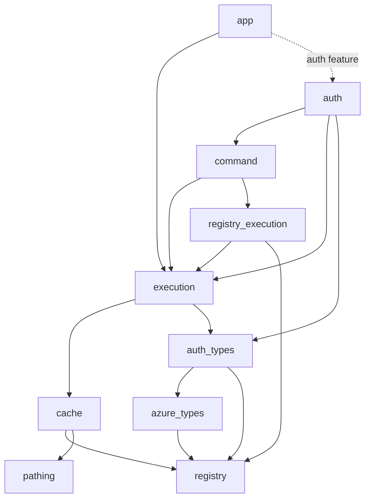

# Executor and cache public contracts

**Decision record:** G1–G4 for [the migration plan](executor-cache-migration.md).
These are implementation contracts, not a claim that the migration is implemented.
The [coordination contract](executor-cache-coordination.md) supplies G5/G6, including
publication, dependencies, invalidation, and persistence. The
[migration inventory](executor-cache-migration-inventory.md) records affected callers.
The owning plan records compilation evidence for the separate offline contract
sketch; the signatures below describe the selected API.

## G1 — package responsibilities and dependency direction

U59–U61 revise the original package proposal after the completed types-crate
dependency cleanup. The user selected candidate B: `registry` is the pure
foundation, and `registry_execution` owns execution-aware registration and
invocation. The runtime authentication crate is named `auth`, paired with
`auth_types`. `AzureTenantId` remains in `azure_types`; task 3.1 has moved
`AuthSource` from the former `credentials` crate to `auth_types` and renamed the
runtime to `auth`. Task 3.0 implemented the registry split. Task 3.2 implemented
the executor/provider and application binding with offline verification recorded
in the owning plan. Task 3.3 implemented borrowed registry invocation, offline
shared-output discovery, and direct UI integration; production transport and SDK
request migration remain the subsequent phases.

The concrete `CloudTerrastodonExecutor` belongs in the new
`cloud_terrastodon_execution` crate. It owns capabilities through interfaces and
does not import credential implementations. The `auth` crate supplies
`CredentialAuthenticationProvider`, which implements the execution crate's
`AuthenticationProvider` interface. Application startup supplies the bounded
scope, selected auth context, and cache owner; `AppContext::executor()` binds them
to an executor with the injected provider. A separate higher-level executor crate
and a second wrapper around the executor are unnecessary.

The following table lists target edges relevant to this boundary. Other existing
workspace dependencies remain unless a named migration task changes them.

| Package | Required dependency direction | Responsibility |
| --- | --- | --- |
| `registry` | Existing pinned external dependencies only | Pure reflection, erased owned values, offline constructors, pure conversion descriptors, and context-free metadata/planning |
| `azure_types` | `registry`; existing pure domain/HCL/UI dependencies | Azure domain values, including the existing `AzureTenantId`; no dependency on `auth_types` or executor-aware registration |
| `auth_types` | `azure_types`, `registry` | Serializable credential-selection vocabulary, audience, and authorization value contracts; no discovery or token acquisition |
| `cache` | `registry`, `pathing` | Explicit cache owner, typed result ownership, artifacts, generations, and dependencies |
| `execution` | `cache`, `auth_types` | Executor, executable request contract, bounded execution, typed credential capability |
| `registry_execution` | `registry`, `execution` | Executor-aware callbacks, invocation, effect admission, execution-aware discovery, and a common handle for original registrations |
| `command` | `execution`, `cache`, `registry`, `registry_execution` | Subprocess adapter and its execution policy; registrations use their owning layer |
| `auth` | `execution`, `auth_types`, `command`, `registry`, `registry_execution` | Runtime authentication, credential provider implementations, sessions, and invocation-owned token caches |
| `rest` | `execution`, `cache`, `registry`, `registry_execution`; existing dependencies until their callers migrate | HTTP adapter, typed response decoding, and response artifacts |
| SDK and CLI crates | The lower interfaces/adapters they use | Operation procedures and application policy, respectively |
| `app` | `execution`; `auth` only behind its auth feature | Bounded invocation ownership and resource construction |

The diagram shows the cycle-sensitive target edges; arrows mean **depends on**,
not runtime calls. The full package names use the `cloud_terrastodon_` prefix.



Neither `cache` nor `execution` depends on `command`, `auth`, or
`registry_execution`. `execution` may reach `azure_types` through `auth_types`;
this is acyclic only after `azure_types` uses the pure `registry`. There must be
no reverse `azure_types -> auth_types` edge and no `registry -> execution` edge.
New packages reuse existing pinned dependencies; this decision does not
authorize dependency upgrades.

At runtime the executor can call its injected provider, whose implementation in
`auth` can run a token-acquisition command through the executor. That callback
path does not add an `execution -> auth` package dependency. The acquisition
remains credential infrastructure under G3, including sensitive-output retention
and the rule against treating token refresh as an inventory dependency.

Candidate A retained `registry_values` below the current runtime `registry`. It
could provide the same acyclic responsibilities with fewer renames, but the user
selected B's explicit foundation/runtime names. Candidate C would put the runtime
catalogue and invocation machinery inside `execution`, saving a package while
broadening the executor's responsibility and the dependencies of catalogue
consumers. It was not selected. The selected split does not require relocating
tenant identity.

The direct `azure_types` dependency on `command` came only from an unnecessarily
broad Resource Graph decoding bound. Completed task 2.5 replaced it with `Facet`
and removed that edge while keeping response records in `azure_types`. Completed
tasks 2.6–2.7 removed the remaining command paths: Terraform formatting moved
from `hcl_types` into `hcl`, and resource-type generation moved into unpublished
`tools/` maintenance tooling. Task 2.8 placed provider API records in `azure_types`
and their cached tenant-scoped list request in `azure`; the tool owns catalogue
generation and file publication. Those changes did not remove the current
`azure_types -> registry` edge. Completed task 3.0 made that dependency pure
before task 3.1 introduces `auth_types -> azure_types` and task 3.3 gives
`registry_execution` executor-aware callbacks. Task 3.0 moved the existing runtime
callbacks without requiring the new executor; task 3.2 implements `execution`,
and task 3.3 adds the target `registry_execution -> execution` edge.

### Pure registration and executor-aware invocation

Task 2.0 already extracted a working `registry_values` foundation and left
compatibility exports and executable registration in `registry`. That is verified
historical foundation, not the target package naming. Completed task 3.0 absorbed
those pure facilities into `registry`, moved runtime facilities to
`registry_execution`, and removed the `registry_values` package and compatibility
paths in one full cutover.
The pure foundation owns:

- `RuntimeValue`, its owning-allocation operations and pointer bridge;
  `BorrowedPointerKind` and its distributed slice.
- `Thing`, `RegistrationSite`, the value-registration slice, boxed conversion
  helpers, and reflection helpers used by those types.
- `register_thing!` and `register_borrowed_pointer_kind!`.
- `ArbitraryBytes`, a pure `ArbitraryRegistration` descriptor, its distributed
  slice, and `register_arbitrary!`.
- Pure `From`/`TryFrom` descriptors and their registrations, including the Entra
  principal conversions currently registered from `azure_types`. A conversion
  needing runtime capabilities or declaring effects belongs to the runtime layer.
- Context-free operation metadata such as input/output shapes and effect
  declarations. Planning and simulation that inspect only supplied descriptors
  may remain here; wrappers that invoke requests or need an executor belong in
  `registry_execution`.

`ArbitraryRegistration` owns an output shape, a synchronous generator accepting
`&mut ArbitraryBytes`, its boxed-output-to-runtime conversion, and its registration
site. It has no executor, cancellation scope, authentication, or async invocation.
`FunctionDescriptor` owns context-free metadata; `PureFunction` owns a synchronous
pure callback and its descriptor. `RuntimeFunction` owns runtime callbacks,
metadata, and cancellation binding in `registry_execution`. Task 3.0 separates these
responsibilities deliberately. The boundary is runtime
independence, not a rule that every function or every discovery algorithm is
high-level. Task 3.3 subsequently binds runtime invocation to the executor under
G2 without making pure descriptors depend on it.

Each operation has one authoritative registration beside its owning type.
U63–U65 replace the initial optional-provenance adapter design with a copyable
`Function` enum in `registry_execution`:

```rust
pub enum Function {
    Runtime(&'static RuntimeFunction),
    Pure(&'static PureFunction),
    Arbitrary(&'static ArbitraryRegistration),
}
```

Common invocation APIs accept this handle by value. Pure associated constants
remain references to their lower registrations and are wrapped directly with
`Function::Pure` or `Function::Arbitrary`; runtime associated constants supply
`Function::Runtime` handles. Construction is infallible and constant-time, without
registry lookup or allocated adapters. Each variant gets its metadata and callback
from its original record; pure variants cannot carry runtime cancellation state.
Equality, hashing, and deduplication use the variant and original registration
address, never the address of a copied handle. Invocation and cancellation remain
owned by the appropriate registration type. Preserve pure invocation without
authentication and migrate all consumers without compatibility re-exports.

Task 2.0 established the merged `KnownFunctions` view, returned by
`known_functions()`, for original executable registrations and persistent pure
arbitrary adapters. That is historical implementation evidence. Task 3.0's
enum refinement replaces adapter storage with iteration over the original
registration slices, yielding `Function` values. The iterator does not promise
a contiguous slice. Discovery and lookup must use the
merged view rather than assuming the raw `KNOWN_RUNTIME_FUNCTIONS` slice contains pure
registrations. Building or inspecting the catalogue must not invoke generators,
conversions, or executable requests.

The implemented pure `known_function_descriptors()` catalogue contains references
to authoritative descriptors from both layers. It enables metadata-only shape
discovery without a dependency on `registry_execution`. `DiscoveryPlan::build`
accepts an iterator of those descriptors. `Function::descriptor(self)` returns
the original `&'static FunctionDescriptor`, preserving identity when a caller
combines catalogue views or copies handles. Metadata-only consumers use lower
descriptors directly. Each owning registration keeps its callback and descriptor
relationship private; the common handle contains neither copies nor optional
provenance fields. The pure associated handles remain directly callable offline.

### Owning files

Each production type gets its own file. The target homes are:

| Home | Types/responsibilities |
| --- | --- |
| `crates/registry/src/` | Existing pure facilities from `registry_values`, pure conversion descriptors, and context-free metadata/planning; cohesive reflection/registration modules |
| `crates/registry_execution/src/` | `Function` enum handles, `RuntimeFunction` records, executor-aware callbacks, lifetime-aware invocation, effect admission, and executable registration |
| `crates/azure_types/src/tenant_id.rs` | Existing `AzureTenantId`, its parsing, Facet representation, arbitrary generation, and pure registration; no duplicate tenant type |
| `crates/auth_types/src/` | `auth_source.rs`, `azure_bearer_auth_source.rs`, `azure_credential_resource.rs`, `authentication_selection.rs`, `azure_devops_auth_selection.rs`, `authorization.rs` |
| `crates/cache/src/` | `work_cache.rs`, `cache_scope.rs`, `cache_key.rs`, `executor_kind.rs`, `cache_operation_owner.rs`, `auth_partition.rs`, `cached_work_spec.rs`, and the coordination types selected in G5/G6 |
| `crates/execution/src/` | `cloud_terrastodon_executor.rs`, `executable_request.rs`, `request_execution.rs`, `authentication_provider.rs`, `anonymous_authentication_provider.rs`, and invocation-observation types |
| `crates/auth/src/` | Runtime files renamed from `credentials`; `credential_authentication_provider.rs` and existing credential/session/token implementations |

Task 3.1 renames `cloud_terrastodon_credentials`/`crates/credentials` to
`cloud_terrastodon_auth`/`crates/auth` and moves the pure `AuthSource` definition
to `auth_types`. Update every consumer's imports, manifest dependencies,
registrations, tests, examples, and documentation in that slice. Remove the old
credentials package and exports; do not add a forwarding package, dependency
alias, or compatibility re-export. `AzureTenantId` retains its existing
`azure_types` public path. `auth_types` uses that same type rather than introducing
a second tenant identity or conversion between identical wrappers. Parsing,
Facet representation, arbitrary generation, and registrations stay beside each
owning definition. Package/type ownership changes alone do not authorize changes
to credential discovery, admission, or session behavior. U67/U68 separately
authorize the identity and persistent-session contracts specified in G3 below.

Task 3.1 was independently compilable before the new `execution` crate existed.
Its runtime identity-policy work used the existing execution plumbing. Task 3.2 introduces
the executor and provider interface, implements `CredentialAuthenticationProvider`
in `auth`, and wires provider injection through the app binding; that task adds the target
`auth -> execution` edge. The target table does not require this provider adapter
or dependency during the earlier rename/extraction slice.

## G2 — request execution, scopes, and lifetime bounds

Requests contain operation data and serializable credential selection. They do
not contain authentication contexts, token caches, cache handles, observers,
`CancellationToken`, or `CancellationScope`. A bound execution value supplies
those resources and is awaitable.

Both public spellings dispatch through the same implementation:

```rust
executor.execute(request).await?;
request.execute(&executor).await?;
```

The selected trait shape is:

```rust
pub type ExecutionFuture<'a, T, E = eyre::Report> =
    Pin<Box<dyn Future<Output = Result<T, E>> + Send + 'a>>;

pub trait ExecutableRequest: Sized + Send {
    type Output: Send;
    type Error: Send + From<CancellationError>;

    fn run<'a>(
        self,
        executor: CloudTerrastodonExecutor,
    ) -> ExecutionFuture<'a, Self::Output, Self::Error>
    where
        Self: 'a,
        Self::Output: 'a,
        Self::Error: 'a;

    fn execute<'a>(
        self,
        executor: &'a CloudTerrastodonExecutor,
    ) -> RequestExecution<'a, Self>
    where
        Self: 'a,
        Self::Output: 'a,
        Self::Error: 'a,
    {
        executor.execute(self)
    }
}
```

`RequestExecution<'a, R>` owns `R` and borrows the executor. Its `IntoFuture`
output is `Result<R::Output, R::Error>` and its future is
`ExecutionFuture<'a, R::Output, R::Error>`. Direct execution preserves the
request's error, including recoverable partial output, without requiring that
error to implement `std::error::Error`, `Sync`, or `'static`. Cancellation converts
through `From<CancellationError>`. Infrastructure futures default to
`eyre::Report`; existing requests can select that error explicitly. The optional
`.with_invalidation(...)` combinator additionally requires `From<eyre::Report>`
to represent invalidation failure without erasing the request's own failures.
On execution the binding clones the resource handles,
opens a linked child through the current scope's `cancellable_scope`, binds the
factory's child scope into the child executor, and calls `request.run(child)`.
Nested requests receive that child executor. No hidden current executor or
task-local resource fallback is introduced.

The executor is cheaply cloneable. Its private runtime fields protect ownership
of the provider, cache, bounded scope, and dependency lineage; these are concrete
resource/lifecycle responsibilities. Startup constructs it inside the existing
App handler's bounded scope. Executor construction does not manufacture a root
token, an unbound placeholder scope, or an independent request lifetime. Child
scope rebinding is internal; public `cancellable_scope`, `with_async_scope`,
`deferred`, and `finish_required` helpers pass correctly bound child executors to
their callbacks. Explicitly dropping a future still can abandon work; the executor
does not promise protection beyond the underlying cancellation contract.

The minimal task 3.2 app binding retains the existing public `AppContext::auth`
and `AppContext::cancellation` fields until their callers migrate. The context
owns one private `WorkCache`; `executor()` builds a cheap bound handle from those
current fields and the shared cache. Repeated auth wrappers retain the same
`AuthContext`-owned credential session. Already-returned executors retain their
original binding if the caller replaces a context field. No independently stored
executor snapshot competes with those fields. Startup selects the separate
`commands/work` cache directory and performs lexical root validation without
reading or creating it; parsing never constructs this runtime binding.

`WorkCache::new(path)` owns the location only and never deletes it on drop.
`WorkCache::from_tempdir(directory)` transfers a `TempDir` and its cleanup policy;
`WorkCache::temporary()` creates a fresh directory with automatic cleanup. The
shared cache state retains that guard through clones, artifact handles, and
blocking artifact workers, then drops cached values before the guard. Copied
paths do not extend ownership. Cleanup uses `TempDir`'s best-effort drop behavior.
Tests can return an executor owning a temporary cache without a separate guard.

The pinned cancellation API accepts factories of the form
`FnOnce(CancellationScope) -> F`, where `F: IntoFuture<Output = Result<T, E>>`
and `E: From<CancellationError>`. It does not impose `'static` callbacks or
outputs. The execution wrapper must preserve these lifetimes. It must also
preserve the distinction between protected new work and already-owed cleanup.
The initiating caller owns a shared read attempt; cancelling it cancels that
attempt, releases initializer ownership, and permits a surviving waiter to retry.
No detached cache-fill task is introduced.

A completed cancellation wrapper may still own its inner future until the
wrapper is dropped. An owner must release that wrapper before awaiting another
caller whose retry needs the inner future's initializer ownership. A normal
lexical scope or explicit drop supplies that boundary; retaining a completed
pinned wrapper must not prolong the work's locks while waiting on its successor.

An ordinary `cancellable_scope` creates a child ownership boundary while sharing
the parent's cancellation intent. Calling `request_cancel` on that scope is not
an isolated cancellation of one sibling. Tests of a surviving waiter must use
independent caller signals established by their owners, or explicitly drop the
initiating caller's future; they must not assume an ordinary child scope has an
independent token. Pinned cancellation version 0.7 provides
`cancellable_child_scope` and `with_async_child_scope` for independent child
signals behind its `inheritance` feature. Task 3.3 exposes both through the
executor for independently cancelled UI jobs and cooperative UI shutdown, enabling the pinned
feature. The returned future owns its executor clone; resources, cache ancestry,
and authorization restrictions remain inherited. Root cancellation cancels all linked
callers and does not leave a waiter authorized to retry.

Only APIs retaining shared decoded values impose `T: Send + Sync + 'static`.
They return `Arc<T>`. Ordinary executable outputs remain `Send` and may borrow
data with a valid invocation lifetime. Cache initializer futures need not be
`'static`: the caller owns and awaits them. Fixed canonical decoding can use owned
inputs on a blocking worker, while per-caller callbacks remain outside that
worker and outside the cached operation.

### Canonical execution versus caller policy

An operation owns one canonical decoder and one reusable result contract.
`CachedWorkSpec` represents that executable/cache contract and binds to the
executor before awaiting. It is not a serializable request DTO: execution
closures and runtime ownership naturally belong to the bound work.
The low cache specification receives generic execution/decoding callbacks and
explicit cache/scope inputs through an execution-layer adapter; it does not
import `CloudTerrastodonExecutor` or a credential provider back into `cache`.
Authentication admission supplies an `AuthPartition` before that adapter asks
the cache to reuse an entry.
The execution adapter rechecks admission at binding, before cache access, before
and after initialization, and before returning a result. Each check must still
admit the same partition. Revocation or identity changes while waiting cannot
authorize receipt or retry under the old binding, and changes during
initialization cannot publish that output under its earlier partition.
An admission error from semantic child work makes the active parent and its
ancestors nonreusable even if the parent catches the error. The cache exposes
`WorkAttempt::prevent_reuse` for that execution-layer boundary and rejects using
a completed token to revoke an accepted result.

Task 4.1b adds `CloudTerrastodonExecutor::cached_work_with_artifacts` for adapters
that also retain raw outcomes. It uses the same typed-work admission procedure
and passes `(executor, ArtifactEntry)` to the initializer. The entry has the exact
admitted identity and active initializer token, so disk decoding can return
`LoadedArtifact::decoded(value)` with its original age and generation proof.
Constructing an unbound entry through `cache().artifacts(...)` cannot supply that
proof. Memory hits bypass the initializer, including raw loading and decoding.

The artifact entry has zero effective validity for `ExecuteEveryTime`, including
when the requested validity is positive. Its raw outcomes may be retained but
cannot replace execution or become reusable selections. Disabled raw retention
does not disable decoded memory sharing; credential infrastructure is excluded
from general semantic work. The initializer remains responsible for
canonical decoding, retaining failures, and selecting accepted leaf artifacts.
Callers retain the operation's cancellation/deferral policy.

`CloudTerrastodonExecutor::uncached_work` returns an owned `T: Send` that may
borrow invocation data. Each call has an independent linked cancellable scope;
there is no cache identity, lookup, joining, or retained result. The artifact
variant, `uncached_work_with_artifacts`, claims the canonical operation and output
type synchronously, then supplies an entry for the admitted partition with zero
validity. That ownership claim requires `T: 'static`, but neither owned API needs
`Sync` or wraps its output in `Arc<T>`. Raw outcomes may be retained without
reusing or selecting them; disabled retention still suppresses all raw I/O.

Owned work uses the same binding admission and before-poll/after-result identity
checks as shared work. A reusable initializer cannot admit it, and catching that
rejection still poisons ancestor reuse and quarantines already-published artifacts.
Credential infrastructure cannot enter either owned boundary. Effects, canonical
decoding, and required artifact completion belong inside the caller's deferral;
the linked scope inherits that protection. These task 4.1b boundaries preserve
the owned contract used by explicitly managed Command execution.

U87/U88 narrow the Command boundary. `run`/`run_raw`, their polite variants,
and ordinary mapper/validator APIs take only a `CancellationScope`. They use no
work cache or provider and persist no execution artifacts. Explicit cache keys
are rejected on that path rather than silently ignored. Local file/formatting
helpers and fresh local configuration reads need only this scope-based contract.

`run_with_artifacts`/`run_raw_with_artifacts`, their polite variants, and
`run_with_artifacts_and_mapper`/`run_with_artifacts_and_validator` use the executor
boundaries above, execute independently, and retain owned outcomes; cache keys
identify zero-validity artifacts only. `run_cached`/`run_raw_cached`
and cached polite variants require an explicit `CacheOperationOwner` and return
`Arc<T>`. JSON output is canonical for the typed API; raw status/stdout/stderr is
canonical for the raw API. Shared execution requires captured output. The
fingerprint includes CommandKind because kinds may transform the same arguments
differently even when they select the same executable. Caller mapper/validator
variants do not change canonical identity. `ArtifactEntry::reject` rejects an
exact selected disk result without clearing sibling variants or child pages.

Managed subprocess execution uses anonymous executor admission, meaning no
executor credential lookup. Plain execution needs no admission provider. Neither
path sandboxes external program credentials. Cancellation-only helper functions
receive scopes directly, not executors or substitute context bags. Executor child
callbacks preserve ancestry/restrictions only for children needing those resources.
Semantic requests retain admission before invoking the scope-only process layer;
the physical transport itself cannot infer cache ancestry from a scope.
Azure/DevOps service subprocesses were replaced by explicit-context REST calls;
credential acquisition and local logout remain isolated auth infrastructure.
Tea receives an explicitly matched login profile and uses explicit managed owned
execution because profile names do not establish credential generations. The
REST now follows the same explicit ownership boundary in task 4.2.
`receive`/`receive_raw` execute independently and return owned values;
`receive_cached`/`receive_raw_cached` require a canonical operation owner and
return shared `Arc` values under `ExecutorKind::Rest`. Every receive takes the
executor, while constructors retain nonsecret authentication selection and no
cancellation or credential handle. Context setters only extract source/tenant.
Cached mapper/validator APIs apply caller policy after obtaining the canonical
result. Graph and ACR authorization remain provider-owned credential work, with
the latter constrained by a validated challenge. U100/U101 and task 4.2b carry
shared ownership through cached SDK outputs and their consumers. Singletons
return `Arc<T>`; single-page collection envelopes can hold `Arc<Vec<T>>` and
return that handle; paginated and composed lists retain decoded `Arc<T>` items
in `Vec<Arc<T>>`. An outer aggregate cache remains a separate phase 5 concern.
Do not detach the retained value with a deep clone or wrap a newly cloned record
in an `Arc` on each invocation. No `Clone` bound is required for canonical shared
results. Ordinary uncached receives and intentional domain projections retain
owned outputs.

`receive_converted` and `receive_converted_cached` execute a fixed
`TryFrom<Wire>` conversion inside the decode/artifact boundary. The cached form
retains the converted value, so a cache hit performs neither wire decode nor
domain conversion. Both wire and domain type identities belong to its memory
contract; a mismatched interpretation is rejected before reuse. Conversion
errors retain the original response artifacts and owning request attribution.
This contract covers Resource Graph row decoding without treating an arbitrary
caller mapper as the operation's canonical conversion.
An arbitrary validator/mapper is caller policy. It runs for every caller after
obtaining the canonical result, including hits and joiners, and its output is
not automatically memoized. Different callbacks returning the same Rust type
must not be treated as equivalent canonical decoders. A caller's validator
failure does not invalidate a canonical result accepted by the operation's own
decoder. Canonical decoding failure retains raw artifacts and follows the shared
cache rejection policy.

Borrowed observers and validators may also be non-`Send`. They execute in a
per-caller wrapper around the `Send` request future, not inside `ExecutableRequest::run`
or a retained cache entry. Consequently that wrapper itself need not be `Send`.
Callers that spawn it are responsible for supplying `Send` callbacks. A projection
may return an owned caller-specific value or a value borrowing caller-owned data;
it does not acquire cache bounds merely because its input was an `Arc<T>`.
Task 3.2 verifies these caller-side lifetimes with synthetic wrappers; it does not
introduce a lifecycle-observer API or migrate transport callback entrypoints.
Those adapter and SDK changes retain their later owning tasks.

### Registry invocation

After the package cutover in task 3.0, task 3.3 gives `registry_execution` an
executable callback that borrows the low-level executor directly. The pure
`registry` never imports this callback or the executor.

The callback and its cancellation policy belong to `RuntimeFunction`.
`Function::Runtime` delegates to that record; the pure and arbitrary handle
variants retain their runtime-independent invocation contracts.

```rust
pub type InvocationFuture<'a> =
    ExecutionFuture<'a, Box<dyn Any + Send>>;

pub type AsyncExecutionFn = for<'a> fn(
    Box<dyn Any + Send>,
    &'a CloudTerrastodonExecutor,
) -> InvocationFuture<'a>;
```

`registry_execution::FunctionInvocation<'a>` carries this pending future or an
already-produced boxed value. Executable dispatch accepts
`&'a CloudTerrastodonExecutor` and returns
`Result<FunctionInvocation<'a>>`. Its generic adapter downcasts the request,
awaits `executor.execute(request)`, and boxes the result. The erased registry
boundary requires `R: ExecutableRequest + Any + Send + 'static`,
`R::Output: Facet<'static> + Any + Send + 'static`, and
`R::Error: Into<eyre::Report> + 'static`, but does not require `Sync`. Only this
adapter converts request errors into reports. A custom conversion owns retaining
useful domain context and source errors for erased consumers. Those conversion
and ownership requirements belong to boxed reflection, not every direct request.

Keep the current async-value callback as a temporary separate executor variant
for legacy requests/conversions. The new executable registration uses the new
callback and does not reflectively inject a cancellation field. Pure conversions
and arbitrary constructors remain callable without authentication or live
execution. UI workers that spawn an invocation own an executor clone and create
and await the borrowed invocation inside that worker.

## G3 — identity, ownership, and credential isolation

`ExecutorKind` has `Command`, `Rest`, `InProcess`, and `Other(String)` variants.
The cache centrally encodes their namespaces. An `Other` namespace cannot alias
a built-in kind or another distinct `Other` value after filesystem encoding.
Callers supply readable logical scope/operation keys; they do not prepend their
own transport namespace.

The ownership address is `(ExecutorKind, logical_operation_key)`. Before any
variant lookup, disk read, wait, or initialization, the cache claims/checks its
canonical operation owner and decoded output `TypeId`. The owner is a declared
operation/decoder contract with a stable in-process marker type. It is not the
caller's source location or the generic `RestRequest` adapter. Borrowed request
implementations may name an owned marker or their owned request specialization;
they do not need to make borrowed input `'static` just to identify the operation.

A different owner or output type for the same ownership address is an error,
even if its auth partition or request fingerprint differs. Check the contract
before selecting those variants. Do not add expected owner, output `TypeId`, or
caller location to the address to turn misuse into a second successful entry.
Keep type names and caller locations for diagnostics. Disk type metadata remains
diagnostic; raw disk payloads use the current operation's canonical decoder.

The concrete reusable entry additionally includes the admitted auth partition
and complete request fingerprint. Memory coordination and physical artifacts use
that same concrete identity. An SDK aggregate occupies `InProcess` while its
REST operation occupies `Rest`, even when both use the same logical key. This
handles the existing location-list wrapper/transport case without weakening
same-namespace ownership checks. Logical prefix invalidation traverses all
namespaces and variants in its selected scope. Physical layout and publication
are specified in G5/G6.

Process fingerprints retain executable, arguments, environment, working
directory, stdin, and adjacent inputs. REST fingerprints retain all semantic
request inputs. Credential material is never a printable key or artifact input.
Authentication selection and the provider's admitted identity distinguish
credential contexts without using a current access token as request identity.

### Serializable authentication selection

`auth_types::AuthSource` retains application selection preferences, including
`Auto` and `None`. Pure `AzureBearerAuthenticationSelection` contains a stable
`CloudTerrastodonAccountId`, concrete `AzureBearerAuthSource`, and explicit
`AzureTenantId`. Principal/ARM requests retain that selection in their
`authentication` field. `AzureDevOpsAuthSelection` distinguishes this bearer
selection from an account-selected PAT. Gitea requests name their account and
instance. No request contains runtime credential caches or cancellation handles.

Aliases and deliberately configured CT defaults resolve before construction.
No active-CLI-tenant or first-account fallback exists. The resource-type tool uses
the shared tenant selector and configured CT tenant default; it no longer consults
Azure CLI's ambient account. Every bearer request contains the resolved tenant,
and every Azure CLI token subprocess receives it explicitly.

The executor owns an invocation-specific provider map keyed by account ID.
`AuthenticationProvider::admit` checks the already-owned source, authority, account,
and generation before a reusable hit. `validate_target` enforces service credential
destinations before reuse or transmission. `lease` retains the admitted binding
for the complete request; retirement tokens cancel optional work while linked
deferrals drain required completion. Pure selection and admission do not fetch a
token, read defaults, or switch accounts.

`authorization` and registry challenge exchange use the executor's bounded
credential-infrastructure scope. `Authorization` owns sensitive runtime headers
with redacted diagnostics. Credential infrastructure cannot access general work
artifacts/caches or recursively request authorization. Infrastructure classification
cannot hide a domain write or user solicitation.

### Auth partitions and their lifetime

The admitted account/session determines a non-secret `AuthPartition`.
Independent CLI/browser/PAT provider sessions keep conservative partitioning;
naming accounts does not automatically promise persistent cross-invocation result
reuse. Workload identity includes its configured identity and account binding.
Gitea remains nonreusable under its external-provider policy. No partition uses
tokens, assertions, PATs, refresh credentials, or secret-derived printable keys.

Selected account ID, source, and tenant survive request serialization and alias or
default changes. Credentials may renew within the captured identity. Explicit
replacement credentials require a new approved account ID when continuity cannot
be proved; an old request never silently follows the replacement. A provider can
admit several accounts without changing execution lineage or the shared cache.

CLI sessions use persistent account-owned generation directories with explicit
tenant/account binding. Browser refresh credentials, PATs, workload assertion
snapshots, and tea configuration snapshots are also account-owned. Ordinary
execution never imports legacy credentials or follows mutable external defaults.
Account login/import are explicit operations; token acquisition stays
noninteractive. Azure/DevOps service operations use REST, not an auth-owned generic
CLI service runner.

Retirement closes new admission, signals optional jobs, drains admitted deferred
jobs, and invalidates the authentication partition before and after draining.
Required response decoding, artifact persistence, and affected-read invalidation
retain the old binding until completion. Cache generations reject stale
publication, and recorded cross-account dependencies invalidate aggregate results.
Previously returned `Arc` snapshots remain readable.

Account retirement and ordinary resource invalidation have different scopes:
retirement targets that credential partition, while mutation invalidation reaches
all account variants of the affected resource. The inner shared-handle protocol
alone does not imply cross-process cache coherence. Phase 8's
[exclusive cache-root ownership](cache-root-ownership.md) serializes independent
cache owners and recovers interrupted disk transitions; it does not turn the
credential store into a cross-process transaction. Durable retirement prevents
new invocations reopening retired generations; separately running processes are
not instantly cancelled. Existing authentication-partition and retirement
admission rules remain necessary inside cache-root ownership.

`AnonymousAuthenticationProvider` admits anonymous/local work and rejects
credential-requiring selections. The default-off `test-support` sentinel
`UnreachableAuthenticationProvider` fails any authentication use.
`TestAuthenticationProvider` supplies synthetic policy, credentials, and call counters.
Local tests also require temporary cache ownership because anonymous execution
alone does not isolate disk state.

The [account companion](accounts-runtime-tests-and-requests.md) closes A1–A4/V1.
The [authentication guide](../authentication.md) documents exact commands,
source-specific storage, legacy import, and continuity limits.

## G4 — shared records, observation, and effect admission

Canonical inventory results use an outer `Arc` so hits and joiners share the
same allocation. Task 4.2b first preserves existing cached values and page-record
handles through SDK consumers; its verification is tracked in the owning plan.
Single-page collections use `Arc<Vec<T>>`; independently selectable page records
use `Vec<Arc<T>>`. This does not memoize assembly of the combined list.

Domain-specific response envelopes name their concrete shared item type, for
example `Vec<Arc<AzureProviderOperationsMetadata>>`. Do not parameterize them
solely to switch between owned and shared records: a default type argument does
not constrain the envelope to its domain. Keep generics on reusable envelopes
that serve different domain types, such as Graph, Resource Graph, PIM, and Azure
DevOps collections.

Phase 5 implements these aggregate cache boundaries:

| Inventory | Shared shape | Assembly/conversion consequence |
| --- | --- | --- |
| Graph category lists | `Arc<Vec<Arc<EntraUser>>>`, corresponding group/service-principal forms | Aggregate construction copies record handles |
| Principal inventory | `Arc<EntraPrincipalCollection>`; `EntraPrincipal` variants hold shared category records | Existing ID/name access remains borrowed; consuming conversions return shared records or explicitly clone owned records |
| Azure DevOps projects | `Arc<Vec<Arc<AzureDevOpsProject>>>` | Pages and final ordered list share project records |
| Combined RBAC | `Arc<RoleDefinitionsAndAssignments>` | The first validated assembly is shared; internal role/assignment record sharing follows the invariant-preserving conversion work in its migration slice |

Each aggregate uses `InProcess` identity and records its actual child requests,
including child memory hits. Only raw leaf responses persist; new cache owners
reassemble aggregates from admitted leaves rather than restoring an unverified
dependency certificate. The implementation and validation evidence belong to
tasks 5.1–5.3 in the owning plan.

Graph category/get/search/pick requests and RBAC inventory requests carry an
explicit tenant and selected bearer source. Project list/pick requests carry an
organization URL and `AzureDevOpsAuthSelection`. The list retains its
`Cow<AzureDevOpsOrganizationUrl>` field: direct calls borrow existing URLs and
deserialized requests own their values. Fix Facet decoding/derive defects in the
forks instead of replacing borrowed request APIs or adding application wire proxies.
A principal lookup uses
`EntraPrincipalLookup` to preserve its known route across text serialization;
the existing `EntraPrincipalId` UUID wire format remains an identity value.

These are targeted ownership changes, not a requirement to replace every nested
domain field with `Arc`. Do not add `Clone` derives to response/domain records
solely so the SDK can turn a shared cache hit into an owned copy. Retain cloning
for a separately required domain edit, transformation, or invocation contract.
Facet/Arbitrary support, external JSON/text behavior,
registry collection projection, and CLI presentation must be verified through
the focused application integration checks. No generated service response
fixture is evidence of remote API compatibility.

Cached snapshots are shared immutable results. An explicit owned edit uses an
owned conversion or copy-on-write; mutation must not change the retained snapshot
visible to another caller. Do not expose mutable access through the cache. Preserve
domain validation when constructing a new edited value. A result remains usable
after cache eviction because its caller owns an `Arc`.

Invocation observers are runtime behavior, never request wire data or cache
policy. Every caller receives its own lifecycle notification: execution admitted,
hit or initialization/waiting status as applicable, and completion/failure. The
initializer can additionally report operation progress. Joiners receive waiting
and completion rather than fabricated page progress; memory hits do not pretend
to re-fetch pages. Observer callbacks are not retained in shared entries and are
not silently skipped on hits. A local wrapper may receive events from the `Send`
execution future while invoking a borrowed, non-`Send` callback in the caller's
task. It must not create detached fetch work to achieve that separation.

The implemented spelling is
`request.execute(&executor).with_invalidation(refresh).observe(callback).await`.
`RequestExecution::observe` wraps the request future with a caller-owned event
receiver. Descendants inherit the sender; cache events identify their concrete
entry. Only the explicitly observed binding emits admission and a terminal event.
Collection progress reports assembly work done by that initializer, including
pages obtained from the leaf cache; it does not claim each page required network
I/O. Concurrent child progress may interleave. A warm aggregate emits a cache hit
without replaying earlier page progress.

Callbacks are synchronous notifications and must return promptly. They may borrow
local, non-`Send` state, but must not synchronously wait for cache or execution
work: a suspended initializer or filesystem operation may still own an async
lock. Event delivery occurs after the producer poll returns, outside synchronous
cache bookkeeping. It is not a cache-quiescence boundary. No observer or callback
is stored in shared cache values, and unobserved execution allocates no observer
closure. Completion/failure describes a polled result; explicitly dropping the
observed future drops its work and callback without fabricating a terminal event.

The operation's cache policy and declared effects are known before parent cache
lookup. A reusable operation may not conceal a domain mutation, solicitation,
or required per-invocation noncacheable child behind a warm parent result. Such
work belongs outside the memoized portion, or the parent is noncacheable.
Dependency discovery while filling an entry is an additional check, not a way
to learn this policy only after a hit has already skipped the body. Credential
refresh is explicitly infrastructure and does not make token expiry the semantic
expiry of an inventory; its authentication admission still precedes reuse.
The full generation/dependency policy is in G6.

## Full cutover and verification obligations

Introduce low contracts and explicitly bound adapters before moving caller
families. Every type move updates all consumer imports and dependencies and
removes old-path exports in the same slice; no compatibility exports or aliases
may bridge phases. Ordinary module re-exports within the owning crate remain valid.
Task 3.0 completes the registry package cutover and removes the compatibility
paths from the earlier extraction while migrating their consumers and associated
handles. Task 3.1 completes the `credentials -> auth` rename and source-vocabulary
extraction. Task 3.3 integrates executor-aware invocation in `registry_execution`;
legacy callback implementations may remain there until their request families
migrate, but old crate paths do not. Temporary execution adapters require an
explicit executor; none may select a global cache, manufacture a scope, invent
a tenant, or resolve an implicit authentication provider.

Direct request `.await`, runtime-bearing request fields, owned versus shared
inventory results, and registry invocation signatures are deliberate Rust API
changes. The migration inventory must cover each consumer. Remove the old
execution path, scope injection, and implicit state in phase 7.1; adapters are
not a permanent alternative API.

Compile the contracts with borrowed request/output examples, a `Send` but
non-`Sync` uncached output, and borrowed non-`Send` caller callbacks. Verify boxed
registry invocation separately from direct invocation and confirm the new
dependency DAG in manifests. Verify after task 3.0 that the normal/build closure
of `azure_types` and `cache` cannot reach `registry_execution`, and after task 3.1
that `auth_types -> azure_types -> registry` has no reverse edge. Confirm removal
of the old package names at their respective cutovers, not merely absence of
direct imports in one crate. The owning plan records actual commands/results.
Further runtime proofs use synthetic values and isolated storage only: no
credential discovery, live service calls, production data, or existing production
cache reads are authorized for development validation.
